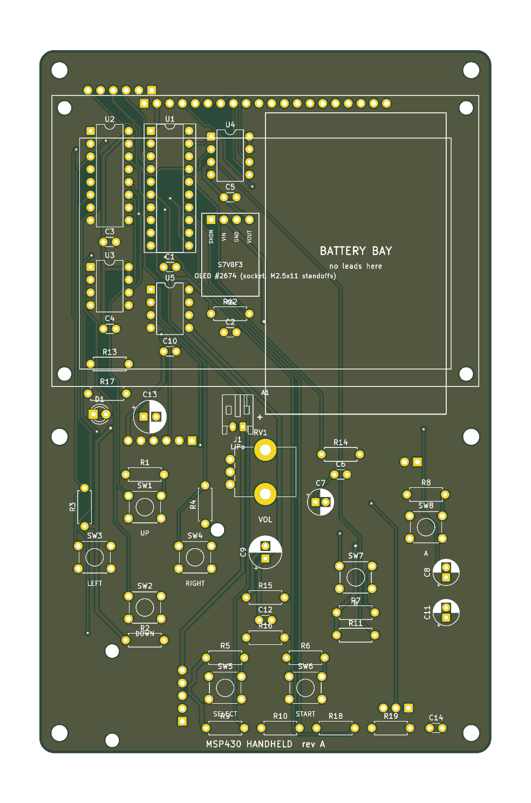
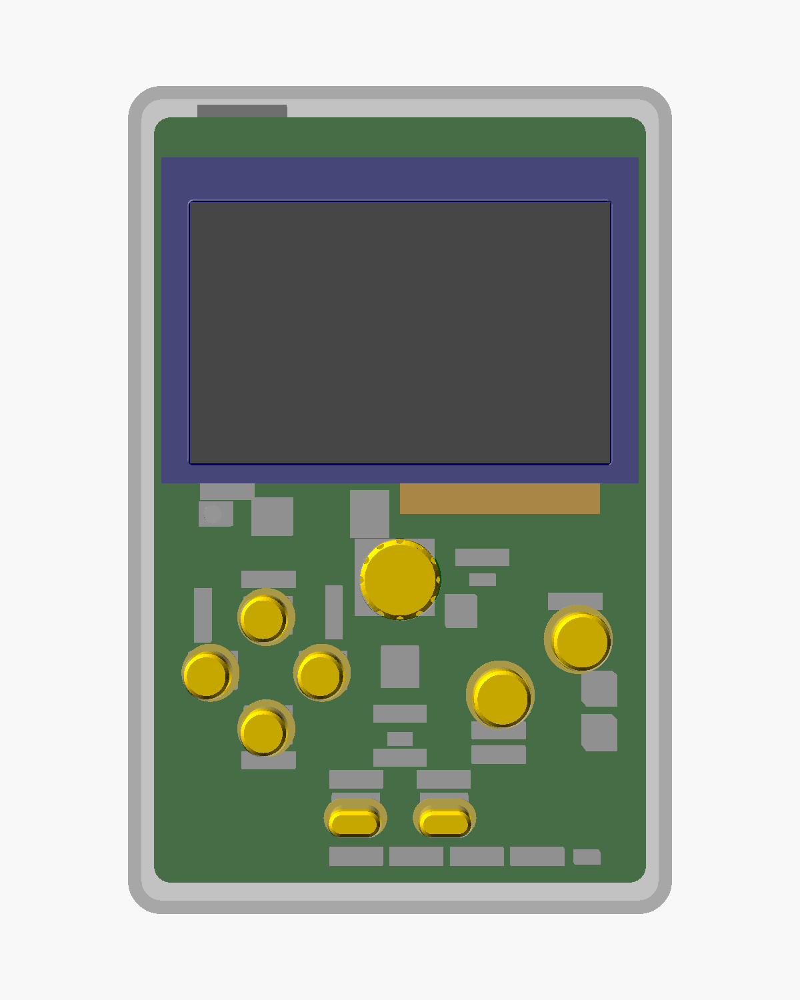

# Handheld rev A: carrier PCB and enclosure

_Design by Claude (Anthropic) for Scott Dean, 2026-11-09. Not yet built or
reviewed by a human; see "Check before ordering"._

A Game Boy-style portrait handheld, 96 x 146 x 32 mm, built from the parts in
BOM Rev F. The **MSP430G2553 (DIP-20, socketed) is on the board.** The
LaunchPad stays on the bench as the programmer: six jumper wires from its
eZ-FET side (J101) to header J3 on the handheld's top edge carry Spy-Bi-Wire
and the UART, so `make flash` (`mspdebug tilib`) and `picocom` work unchanged.
The board is 90 x 140 mm, two layers, all through-hole.

| | |
|---|---|
|  |  |

Schematic: [`schematic/msp430_handheld.pdf`](schematic/msp430_handheld.pdf)
(rev 6.0, generated from the same table as the board and checked against it
pin for pin on every build).

## Stack-up

Seen from the side, player on the right:

```
back plate 2.0 | modules on headers, speaker | PCB 1.6 | ICs + battery 7 mm in the bay | OLED on 8.5 mm socket + M2.5x11 standoffs | bezel flush with the 2.0 face
               |<--------- 10.5 --------->|         |<---------------------- 17.4 ---------------------->|
```

- **Front, top half:** the Adafruit #2674 OLED on a 1x20 socket and four
  M2.5 x 11 mm standoffs (Raspberry Pi HAT hardware). In the 11 mm bay
  underneath: on the left the MCU, 74HC165, 23LC1024, W25Q128 breakout, LM386
  and the Pololu regulator; on the right the LiPo. Nothing is mounted behind
  the battery, so no solder joints touch the cell.
- **Front, bottom half:** D-pad, A/B, Start/Select (B3F-1000), volume pot,
  status LED, the electrolytics (they need the 15 mm of headroom here).
- **Back, bottom half:** PowerBoost 500, USB-C charger (port on the bottom
  edge), power switch, speaker wires. The 40 mm speaker sits in a ring on the
  back shell behind A/B. The back's top half is empty apart from J3.

Height limit in the bay is about 8.5 mm (11.0 minus the parts on the back of
the OLED module). A DIP in a standard socket is about 8 mm: use a low-profile
machined-pin socket for U1, or solder it in and rely on J3.

## Pin map

The PCB follows the **firmware course**, which is what the code is written
against. It differs from schematic rev 5.0 on four signals (see Findings).

| MCU pin | Net | Goes to |
|---|---|---|
| P1.0 | `LED1` | front status LED (1k) |
| P1.1 / P1.2 | `RXD` / `TXD` | J3 pins 3 / 4 (eZ-FET backchannel UART) |
| RST / TEST | `RST` / `TEST` | J3 pins 5 / 6 (Spy-Bi-Wire); RST has 47k to 3V3 and 1 nF to GND |
| P1.3 | - | not connected (S2 on the LaunchPad) |
| P1.4 (A4) | `VBAT_SENSE` | battery / 2 through 470k + 470k, 100 nF |
| P1.5 / P1.6 / P1.7 | `SCK` / `MISO` / `MOSI` | OLED, SRAM, flash, 74HC165 |
| P2.0 / P2.1 / P2.2 | `OLED_CS` / `OLED_DC` / `OLED_RST` | OLED pins 15 / 4 / 16 |
| P2.3 | `SR_LOAD` | 74HC165 SH/LD |
| P2.4 (TA1.2) | `AUDIO_PWM` | 1k + 100 nF, 10 uF, volume pot, LM386 |
| P2.5 | `SRAM_CS` | 23LC1024 |
| P2.6 (XIN) | `FLASH_CS` | W25Q128 (clear `P2SEL` bits 6-7 first) |
| P2.7 | - | not connected |

74HC165 inputs: A Up, B Down, C Left, D Right, E Select, F Start, G B, H A.
Full pin-level list: [`pcb/NETLIST.md`](pcb/NETLIST.md).

**Power** follows POWER-REVIEW.md: LiPo -> PowerBoost (5 V, LM386 only) and
Pololu S7V8F3 (3.3 V logic). The slide switch
does not carry battery current: it grounds `PWR_EN` (PowerBoost EN + Pololu
SHDN), which draws well under 0.1 mA when off. The battery plugs into J1 on
the PCB, not into the charger's own jack.

**J3** (back, top-left, right-angle, reached through a slot in the top wall):
1 GND, 2 3V3, 3 RXD, 4 TXD, 5 RST/SBWTDIO, 6 TEST/SBWTCK. The G2ET's J101
block is labelled GND, 5V, 3V3, RXD, TXD, SBWTDIO, SBWTCK; pull its jumpers and
wire the emulator side across, matching labels rather than positions. Leave pin 2 unconnected when the handheld is running
from its own battery; connect it only to power the board from the LaunchPad
with the handheld switched off. There is no crystal: the course runs on the
DCO and VLO, which is also why P2.6 is free for the flash chip select.

## Findings in the existing design

1. **Pin map conflict between the two repos.** Schematic rev 5.0 has SRAM_CS
   P2.3, FLASH_CS P2.4, SH/LD P2.5, audio P1.2. The course (lessons 16, 17, 25)
   uses SH/LD P2.3, audio P2.4, SRAM_CS P2.5. P1.2 is also the UART TX the
   course uses in lesson 23. The board follows the course; flash CS moved to P2.6.
2. **74HC165 fights the SRAM and flash on MISO.** Its QH output never
   tri-states. Added R13 (1k) between QH and MISO so the memories can
   overdrive it.
3. **Chip selects float during reset.** Added 10k pull-ups on OLED_CS,
   SRAM_CS and FLASH_CS (R9-R11).
4. **The OLED has a 20-pin header**, not 7, and ships in parallel mode: move
   R18/R20 to R19/R21 on the module for SPI (Adafruit's guide). There is no
   level shifter on the module; at 3.3 V none is needed.
5. `wiring/phase-2` lists the flash breakout's pins 5-8 in the wrong order.
   Adafruit's board file gives the standard order (5 DI, 6 CLK, 7 HOLD, 8 VCC),
   which the PCB uses.
6. With MSB-first SPI the 165's H input arrives as bit 7, so the bit table in
   `wiring/phase-3` (A = bit 7) is reversed. Firmware-side only.

## Check before ordering

These are the dimensions I could not get from a drawing. Each is one number in
`pcb/handheld_design.py`; rebuild after changing it.

| What | Assumed | Source |
|---|---|---|
| OLED header row: centred, 1.6 mm below the module's top edge | `OLED["hdr_y"]` | scaled from Adafruit's photos, +-0.5 mm |
| OLED mounting holes: 2.5 mm in from each corner | `OLED["holes"]` | same |
| OLED bezel: 74 x 46, 5.5 mm from the left, 8.5 mm from the top | `OLED["bezel"]` | same |
| Parts on the back of the OLED module are under 2.5 mm tall (battery clearance is about 1 mm) | - | photo |
| U1 plus its socket is under 8.5 mm tall | `U1` | standard sockets are borderline; see Stack-up |
| Pot is the vertical PTV09A; shaft axis 7.0 mm from the pin row | `RV1` | KiCad PTV09A-1 footprint; BOM part is -4 |
| Pololu pin order SHDN, VIN, GND, VOUT | silkscreen names each hole | if the board's own labels run the other way, mount it face down |
| JST-PH polarity: J1 pin 1 = battery + (marked `+`) | derived from Adafruit's charger board file | **check with a meter before plugging the cell in** |
| Speaker is 40 mm, up to 6.5 mm deep | `SPEAKER` | BOM part number does not resolve (see datasheets/README) |
| 220 uF / 10 uF electrolytics are at most 12 mm tall, 6.3 / 5 mm diameter | footprints | BOM MPN suffixes are ambiguous |

## Parts this adds to BOM Rev F

The three BOM files are not updated yet.

| Qty | Part |
|---|---|
| 1 | 1x20 female header, 2.54 mm, 8.5 mm tall (OLED) |
| 1 | MSP430G2553IN20 (or move the one from the LaunchPad) + low-profile DIP-20 socket |
| 1 | 1x6 right-angle pin header (J3) + 6 jumper wires |
| 1 + 1 | 47k resistor, 1 nF capacitor (reset) |
| 4 + 8 | M2.5 x 11 mm standoffs + screws/nuts |
| 6 | M3 x 20 pan-head screws |
| 1 | JST S2B-PH-K-S battery header |
| 1 | 3 mm red LED |
| 2 | 470k resistor; 1 x 47 nF (optional Zobel) |
| +3 / +2 / +1 | 10k (now 11), 1k (now 3), 10R (now 2) |
| +3 | 100 nF (now 7) |
| - | pin strip for the three modules; foam tape for the battery |

No longer needed on the PCB build: breadboard, LaunchPad stacking headers.

## Files and how to rebuild

```
pcb/handheld_design.py     the one table: parts, nets, positions, mechanical numbers
pcb/gen_pcb.py             builds the board with KiCad's Python API
pcb/build.sh               place -> Freerouting -> GND pours -> DRC -> schematic + netlist check -> gerbers, drill, DXF, STEP, renders
scripts/gen_schematic.py   draws schematic/msp430_handheld.kicad_sch (+ .pdf) from the same table
scripts/check_netlist.py   fails the build if schematic and PCB differ on any pin
pcb/msp430_handheld.kicad_pcb / .kicad_pro
pcb/fab/                   gerbers, drill files, msp430_handheld-outline.dxf, board STEP
pcb/NETLIST.md, pcb/DRC.txt
enclosure/handheld_enclosure.scad   parametric; reads the generated board_params.scad
enclosure/build.sh, check_stl.py
enclosure/stl/             front, back, cap_dpad (x4), cap_ab (x2), cap_pill (x2), knob, slider
```

```sh
FREEROUTING_JAR=~/freerouting-2.5.0.jar pcb/build.sh    # docker: kicad/kicad:9.0, eclipse-temurin:25-jre
enclosure/build.sh                                      # docker: openscad/openscad
```

The generators are Python because KiCad's scripting API is, matching
`scripts/gen_kicad7.py`. `schematic/msp430_gameboy.kicad_sch` (rev 5.0, the
breadboard design) is kept as history; rev 6.0 replaces it for the PCB. The autorouter is not deterministic, so a rebuild
gives an equivalent board, not an identical one.

### Mechanical outline

PCB 90.0 x 140.0 x 1.6 mm, 3 mm corner radius. Front view, origin top-left, mm:

| Feature | Position |
|---|---|
| Case screws, 6 x 3.2 mm | (4, 4) (86, 4) (4, 77) (86, 77) (4, 136) (86, 136) |
| OLED standoffs, 4 x 2.7 mm | (5, 11.5) (85, 11.5) (5, 64.5) (85, 64.5) |
| OLED socket pin 1 / pin 20 | (20.87, 10.6) / (69.13, 10.6) |
| U1 pin 1 / J3 pin 1 (back) | (22.19, 16.07) / (22.35, 8.0) |
| Battery bay | x 45 to 81, y 12.5 to 72.5 |
| Display window (bezel) | x 8 to 82, y 17.5 to 63.5 |
| D-pad Up / Down / Left / Right | (21, 91) (21, 111) (11, 101) (31, 101) |
| B / A | (63, 105) / (77, 95) |
| Select / Start | (37, 127) / (53, 127) |
| Volume shaft / LED | (45, 84) / (12, 72.5) |
| USB-C centre, bottom edge | x = 21.5 |
| Power switch (back) / speaker centre (back) | (71, 131) / (66, 103) |

Enclosure: 95.8 x 145.8 x 31.5 mm, 2.4 mm walls, split at the PCB's front
face. Front shell prints face down, back shell plate down, caps and knob top
down, all without supports. The power slider needs supports under its plate.

## What has and has not been verified

Verified by tool, on every build:

- All 56 parts placed and every net routed. KiCad DRC: 0 unconnected, 0
  clearance, courtyard or hole violations. The remaining advisories are
  silkscreen overlaps, listed in `pcb/DRC.txt`. The DRC gate fails on the
  unrouted board.
- Schematic and PCB agree on all 39 nets and 56 parts, pin for pin
  (`check_netlist.py`; it fails when one pad's net is changed). ERC reports no
  errors; the two warnings are the flash WP/HOLD pins tied to 3V3, which is
  intended.
- All seven STLs are closed meshes. Pad positions computed for the enclosure
  are asserted against KiCad's own for every footprint.

Not verified: nothing has been fabricated, printed, or fitted, and no firmware
has run on it. Enclosure clearances were checked by section views and
arithmetic only. Some silkscreen labels overlap. The schematic is a labelled
netlist drawing (every pin has a net label, grouped by function), not a
hand-drawn wiring diagram.
